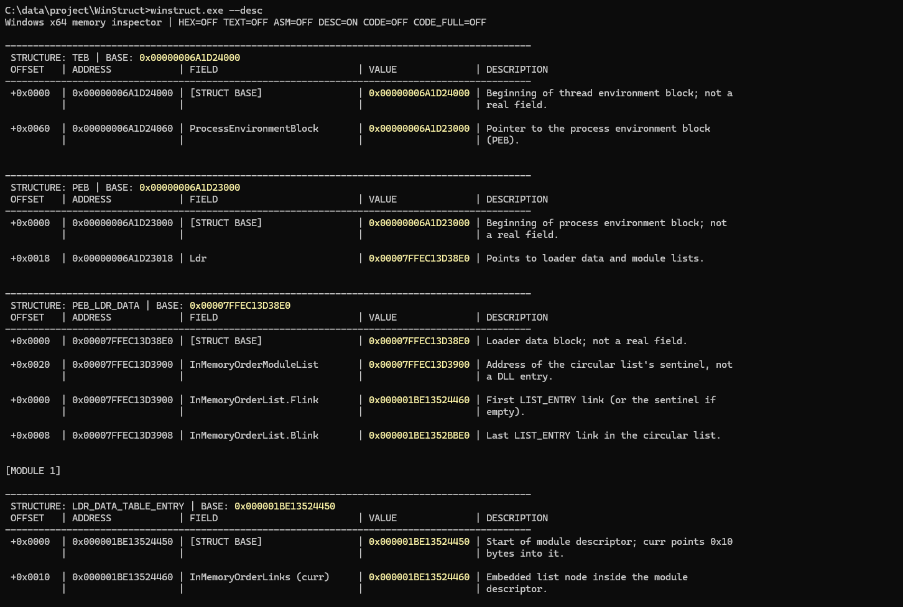
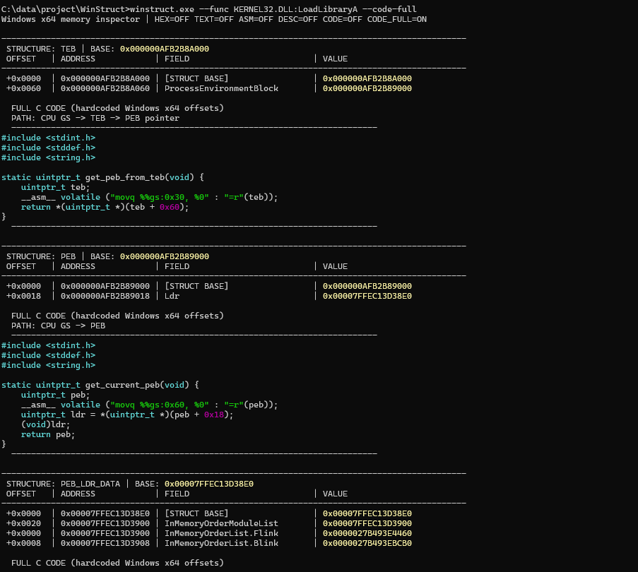
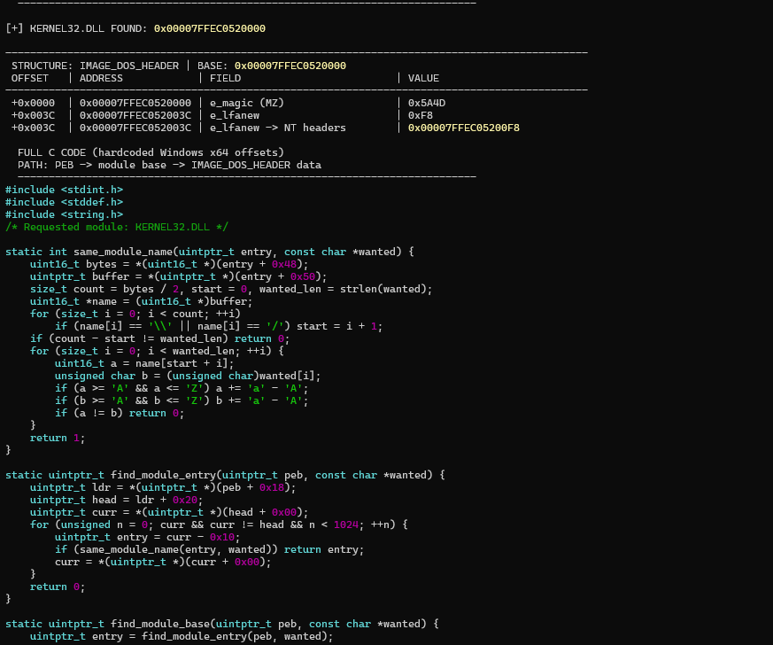
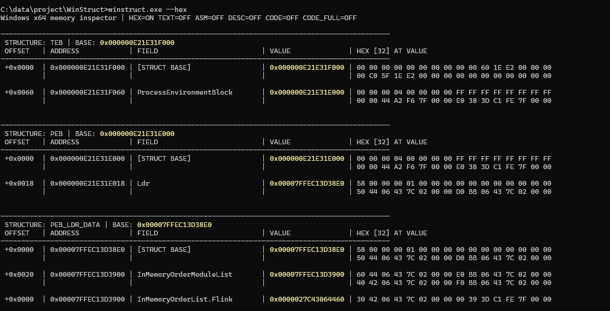

# WinStruct

**Explore Windows internals, one pointer at a time.**

WinStruct is an educational, command-line project for exploring how Windows organizes processes, memory, and system-level data. It aims to make low-level concepts easier to inspect and understand by combining readable tables, raw memory views, field explanations, and reproducible C examples.

The project is intentionally **not limited to a particular Windows structure**. Its current implementation focuses on process loader data, but the long-term goal is to provide a growing set of tools for learning about Windows internals and memory organization.

> [!NOTE]
> WinStruct is an evolving learning project, not a production debugger, forensic tool, or comprehensive disassembler.

## Current capabilities

The initial Windows x64 implementation can:

- Follow pointers through selected process-internal structures and enumerate loaded modules.
- Display field offsets, addresses, and values in aligned console tables.
- Highlight important addresses for easier pointer tracing.
- Optionally show hexadecimal memory previews, 30-byte ASCII previews, field descriptions, and C pointer-arithmetic examples.
- Attempt limited, built-in x86-64 instruction decoding for executable memory regions, without external disassembly libraries.
- Resolve a named DLL export by walking and displaying each in-memory PE structure involved.

The optional table columns are disabled unless their corresponding flag is supplied. They are designed to keep related information grouped, even when a cell spans multiple lines.

## Screenshots



*`--desc` adds concise explanations next to the TEB, PEB, loader data, and module-entry fields.*



*`--code-full` prints complete C paths below each section, starting with the TEB, PEB, and loader list.*



*The expanded walkthrough reaches the selected module and its PE headers using pointer arithmetic and hardcoded offsets only.*



*`--hex` adds a 32-byte hexadecimal preview for every readable pointer destination.*

## Build

**Requirements:** Windows x64 and a MinGW-w64 x86-64 GCC toolchain.

```bash
x86_64-w64-mingw32-gcc.exe winstruct.c -O2 -s -static -o winstruct.exe
```

## Usage

```bash
winstruct.exe [--func DLL:Function] [--hex] [--text] [--asm] [--desc] [--code|--code-full] [--help]
```

| Option | Purpose |
| --- | --- |
| `--func DLL:Function` | Find an already loaded module through the PEB, resolve an exact named export, and display every PE structure and lookup-array element used. |
| `--hex` | Add a column containing up to 32 bytes from each pointer destination. |
| `--text` | Add a column containing up to 30 bytes from each pointer destination as ASCII, replacing every byte outside `0x20`–`0x7E` with `.`. |
| `--asm` | Attempt to decode up to 10 instructions from up to 64 bytes of executable memory. |
| `--desc` | Add concise explanations of fields to the table. |
| `--code` | Add syntax-highlighted C snippets using only explicit Windows x64 offsets, fixed array strides, and pointer arithmetic; the displayed code does not depend on SDK structure definitions. |
| `--code-full` | Print a complete, syntax-highlighted PEB-to-data C walkthrough below every relevant structure. This is mutually exclusive with `--code`. |
| `--help` | Show the available options. |

Options can be combined:

```bash
winstruct.exe --desc --code
winstruct.exe --hex --desc
winstruct.exe --text --desc
winstruct.exe --hex --asm --desc --code
winstruct.exe --func KERNEL32.dll:LoadLibraryA
winstruct.exe --func ntdll.dll:NtCreateFile --code
winstruct.exe --func KERNEL32.dll:LoadLibraryA --code-full
```

Running without options displays a more compact view.

`--desc`, `--code`, `--hex`, and `--text` are independent, opt-in columns. `--code-full` is an opt-in block shown below the tables rather than a column. In particular, `--func` does not enable `--desc` automatically:

```bash
# PE tables without descriptions
winstruct.exe --func KERNEL32.dll:LoadLibraryA

# The same lookup with field descriptions and hardcoded-offset C snippets
winstruct.exe --func KERNEL32.dll:LoadLibraryA --desc --code
```

## Named export lookup

`--func` accepts a module basename and an exact export name separated by a colon:

```text
--func DLL:Function
```

The module must already be loaded in the current process. WinStruct locates it through the PEB loader list and does not load missing DLLs. DLL basename matching is case-insensitive, while export-name matching is exact and case-sensitive.

The resolver does not call `GetProcAddress`. It walks and displays the same in-memory data used by a manual named-export lookup:

1. `TEB` and `PEB` locate `PEB_LDR_DATA`.
2. `LDR_DATA_TABLE_ENTRY` supplies the mapped DLL base.
3. `IMAGE_DOS_HEADER.e_lfanew` locates `IMAGE_NT_HEADERS64`.
4. The export `IMAGE_DATA_DIRECTORY` locates `IMAGE_EXPORT_DIRECTORY`.
5. `AddressOfNames` is searched for the requested ASCII name.
6. `AddressOfNameOrdinals` selects an index in `AddressOfFunctions`.
7. The selected function RVA is added to the mapped DLL base to produce its VA.

All RVAs and array spans are checked against `SizeOfImage` before they are dereferenced. If the selected function RVA falls inside the export-directory range, it represents a forwarder string rather than callable code. WinStruct prints the forwarder target and reports that distinction.

## Optional data columns

- `--hex` reads at most 32 bytes at pointer destinations and formats them as hexadecimal.
- `--text` reads at most 30 bytes at pointer destinations. Printable ASCII is preserved and all other byte values appear as `.`.
- `--desc` adds the field-description column only when explicitly requested.
- `--code` adds reproducible C expressions based on fixed Windows x64 offsets. These snippets use integer types, pointer arithmetic, hardcoded field offsets, and explicit array strides such as `i * 4` or `i * 2`; they do not use Windows SDK structure definitions.
- `--code-full` prints complete C paths below the relevant TEB, PEB, loader, module, DOS, NT, data-directory, export-directory, and final export-lookup sections. Each block starts at the current PEB (or shows how the PEB itself is obtained), repeats every required hardcoded transition, and does not use Windows SDK structure definitions. Because it is intended as the expanded alternative to the compact `--code` column, combining the two flags is rejected.
- `--asm` only attempts decoding when the destination belongs to an executable memory page.

Both C modes use native Windows console colors for syntax highlighting: keywords and integer types are cyan, numeric constants and offsets are magenta, strings and character literals are bright green, and comments are green. No ANSI escape sequences are written, so redirected output remains plain text.

## Project direction

WinStruct is intended to grow beyond its first process-memory walkthrough. Potential areas include:

- Additional PE directories such as imports, relocations, TLS, and exception metadata.
- Process and thread memory organization.
- Memory regions, protections, and mappings.
- Stacks, heaps, and other runtime data structures.
- Module loading, linking, and symbol resolution.
- Additional visualizations and cross-references between related structures.

These are **possible directions, not implemented features or commitments**. The scope will evolve as the project develops.

## Technical notes

- The current implementation targets **64-bit Windows** and uses architecture-specific offsets. Internal layouts may vary across Windows versions and are not stable public APIs.
- Memory contents and virtual addresses can differ between runs because of ASLR, allocation behavior, and process state.
- A memory region being executable does **not** prove that every byte in it is a valid instruction. The built-in decoder supports only a subset of x86-64 and stops on unsupported or incomplete instructions.
- Inspecting internal loader lists assumes they remain consistent during traversal. The current implementation should not be treated as a hardened general-purpose memory inspector.
- The project reads memory in the context of the running process; it does not claim to inspect arbitrary remote processes.

## Contributing

Suggestions, corrections, and small, well-explained improvements are welcome. When proposing support for a new structure or Windows version, include the relevant architecture, assumptions, and a way to reproduce or validate the results.

## License

No license has been selected yet. Add a `LICENSE` file before inviting code reuse or outside contributions.
